# Penetration Testing Report

**Footprinting & Network Scanning Phases**
`W2-PM-FINAL | CYBERSECURITY | NETWORKWALKS`

| Field | Details |
|---|---|
| **Pentester Name** (Cybersecurity Professional) | **Mustabshra Rehman** |
| **Program/Batch** | B084-Networkwalks |
| **Date** | 11 November 2026 |
| **Modules completed** | W2-PM1 (Multiple Kali Tools), W2-PM5 (Zenmap Scanning) |
| **Client/Target** | 1. Networkwalks (`networkwalks.com`, educational lab scope) <br> 2. My own local LAN network |
| **Permission secured from client?** | Yes |
| **Phases covered** | **Phase 1:** Reconnaissance & Footprinting <br> **Phase 2:** Scanning & Network Discovery <br> **Phase 3-5:** In Progress |

---

## 1. Liability Disclaimer

I have performed these activities only on the systems and devices where I had secured written permission or the devices/systems that I own myself. All these materials are for education and research purpose only. Do not use anything from here to break the law. The instructor, the authors and Networkwalks are not responsible for what you do with this knowledge. Every action you take is your own responsibility. Misuse can lead to criminal charges, heavy fines, loss of your job and a permanent record. In most countries unauthorised access is a crime even when nothing is damaged.

---

## 2. Introduction

This report covers footprinting the `networkwalks.com` domain using multiple Kali Linux tools (W2-PM1) and scanning my own local network with Zenmap (W2-PM5). One module covers the footprinting phase and the other covers the scanning phase, so together they show how an attacker moves from gathering public information to mapping live hosts on a network. It is the Week 2 part of my ongoing internship program at Networkwalks.

All commands were run in Kali Linux (footprinting) and on a Windows PC with Zenmap installed (scanning). Every step below includes the exact command used, the result I observed, a screenshot as evidence, and a short note on why the finding matters from an attacker's point of view.

---

## 3. Tools Used

| Tool | Purpose |
|---|---|
| Kali Linux & Windows | Operating systems used for reconnaissance activities |
| WHOIS | Find domain registration details (owner, dates, name servers) |
| whatweb | Fingerprint web technologies (server, CMS, plugins, IP) |
| nslookup | Resolve the domain name to its IP address using DNS |
| curl -I | Read the HTTP response headers of the website |
| wafw00f | Detect whether a Web Application Firewall protects the site |
| dnsrecon | Enumerate DNS records (SOA, MX, SPF, TXT, SRV) |
| theHarvester (bonus) | OSINT tool to gather emails, subdomains and hosts |
| Zenmap (Nmap GUI) | Scan the local subnet to find live hosts, IPs and MAC addresses |
| Windows CMD | Local IP and MAC address identification (`ipconfig /all`) |

---

## 4. Activities Performed

### 4.1 Footprinting & Reconnaissance

I performed reconnaissance against the `networkwalks.com` domain using six Kali Linux tools: **WHOIS, WhatWeb, Nslookup, Curl, Wafw00f and DNSRecon**. I also explored **theHarvester** as a bonus OSINT tool. Each tool collected a different type of information about the target.

#### 1) WHOIS

```bash
whois networkwalks.com
```

- Registrar: **GoDaddy.com, LLC**
- Created: **2019-11-06**, expires: **2027-11-06**
- Name servers: **NS6135.HOSTGATOR.COM**, **NS6136.HOSTGATOR.COM** (also NS29/NS30.DOMAINCONTROL.COM)
- DNSSEC: **unsigned**, 4 client lock statuses set
- Registrant details are hidden behind **Domains By Proxy, LLC** (WHOIS privacy)

**Attacker view:** the name servers reveal the hosting provider instantly, and dates/abuse contacts can help social engineering. WHOIS privacy is good defense, but registrar and name servers stay visible.

#### 2) WhatWeb

```bash
whatweb networkwalks.com
```

- Web server: **Apache**
- CMS: **WordPress 7.1.4**
- Plugin: **WP Download Manager 3.3.76**, jQuery 3.7.1, Bootstrap 7.1.4 string, Google Tag Manager
- Server IP: **192.232.216.135**
- Exposed email: `info@networkwalks.com`

**Attacker view:** exact software versions can be searched in CVE and exploit databases to find known vulnerabilities.

#### 3) Nslookup

```bash
nslookup networkwalks.com
```

- Resolver used: `8.8.8.8` (Google DNS), answer type: non-authoritative
- Resolved IP: **192.232.216.135**

**Attacker view:** knowing the real IP lets an attacker scan the server directly, find other sites on the same IP and map the infrastructure.

#### 4) Curl

```bash
curl -I https://networkwalks.com
```

- Status: **HTTP/2 200**, server: **Apache**
- Caching layer exposed: `x-nginx-cache: WordPress`
- WordPress REST API endpoint exposed: **`/wp-json/`**
- Cookie set with `secure; HttpOnly` flags

**Attacker view:** headers fingerprint the stack and reveal entry points without loading the full page.

#### 5) Wafw00f

```bash
wafw00f networkwalks.com
```

- WAF detected: **ModSecurity (SpiderLabs)**
- Tool version: wafw00f v2.4.2, only 2 requests needed

**Attacker view:** a WAF changes the attack plan, because naive attempts get blocked or logged.

#### 6) DNSRecon

```bash
dnsrecon -d networkwalks.com
```

- SOA: `ns6135.hostgator.com` (50.87.144.87)
- MX: `mail.networkwalks.com` (192.232.216.135)
- A: `networkwalks.com` (192.232.216.135)
- SPF policy: `~all` (softfail), includes `websitewelcome.com`
- Google site-verification TXT record exposed
- No DNSSEC answer, no SRV records found

**Attacker view:** each record helps understand the email and hosting setup and spot weak spots such as a softfail SPF.

#### Bonus) theHarvester

```bash
theHarvester -h
theHarvester -d microsoft.com -l 1000 -b baidu
theHarvester -d microsoft.com -l 50 -b all
```

- theHarvester 4.11.1 (OSINT: emails, subdomains, hosts)
- Using only the `baidu` source returned no IPs, emails or people
- `-b all` needs API keys for many sources (bevigil, bitbucket, bufferoverun), configured in `/etc/theHarvester/api-keys.yaml`; I stopped the run manually with Ctrl+C

**Lesson learned:** one source can return nothing. Combining sources, and adding API keys, gives a fuller picture.

### 4.2 Network Scanning with Zenmap

For the second activity, I used **Zenmap** to perform network discovery on my local network. The practical required me to identify my local IP address and subnet, discover live hosts, identify their IP and MAC addresses, and generate a network topology.

I first used the Windows `ipconfig` command to identify my local IP address and LAN subnet. I then entered the subnet into Zenmap and selected **Ping Scan** (`nmap -sn <subnet>`) to identify active hosts.

| Item | My result |
|---|---|
| My local IP | `192.168.100.19` |
| LAN subnet | `192.168.100.0/24` |
| Scan command | `nmap -sn 192.168.100.0/24` |
| Live hosts found | `4` |

| # | IP address | MAC address |
|---|---|---|
| 1 | `192.168.100.1` | `5C:B3:95:1F:B3:8F` |
| 2 | `192.168.100.8` | `C6:D4:0B:CB:28:36` |
| 3 | `192.168.100.40` | `80:9D:65:ED:D3:4E` |
| 3 | `192.168.100.19` | `4C-EB-BD-0C-C7-E7` |


After completing the scan, I opened the **Topology** tab in Zenmap, enabled the legend and saved the network topology in PDF format as required by the practical task.

---

## 5. Risk Analysis / Impact

| # | Risk / Finding | Evidence / Observation | Potential Impact | Risk Level |
|---|---|---|---|---|
| 1 | Web technology and version information exposed | WhatWeb identified WordPress 7.1.4 and WP Download Manager 3.3.76 | Attackers may use exposed version information to look for known issues in that software | 🟡 Medium |
| 2 | Server IP address identifiable | Nslookup resolved the domain to `192.232.216.135` | Reveals the network location of the web service | 🟢 Low |
| 3 | HTTP technical information exposed | Curl returned headers and exposed `/wp-json/` and `x-nginx-cache` | Helps technology fingerprinting and further enumeration | 🟢 Low |
| 4 | WAF technology identifiable | Wafw00f identified ModSecurity (SpiderLabs) | Reveals information about the security architecture | 🟢 Low |
| 5 | DNS infrastructure and weak email policy | DNSRecon showed SOA/MX/TXT records, SPF `~all` (softfail), DNSSEC unsigned | Helps build an infrastructure profile; softfail SPF is weaker against email spoofing | 🟡 Medium |
| 6 | Multiple live hosts visible on local network | Zenmap identified `4` live hosts | Unknown or unauthorized devices may be present on a network | 🟡 Medium |

**Risk level key:** 🔴 Critical, 🟡 Medium, 🟢 Low

The risks above are observations from the footprinting and scanning exercises, not confirmed vulnerabilities. No exploitation or vulnerability validation was performed in these two modules. A software version, IP address or DNS record does not by itself mean the system is vulnerable; further authorized testing would be required to confirm any actual vulnerability.

---

## 6. Recommendations

1. **Review publicly exposed technology information:** regularly review what is visible about web technologies, CMS and plugins (versions in headers and meta tags).
2. **Keep software updated:** update WordPress, plugins and server software and check them against current security advisories.
3. **Review HTTP headers:** remove unnecessary technical information such as cache and server details.
4. **Review DNS records regularly:** keep only required records public, enable DNSSEC and use WHOIS privacy.
5. **Harden email authentication:** move SPF from `~all` to `-all` and add DKIM and DMARC.
6. **Properly configure and monitor the WAF:** keep ModSecurity enabled, tuned and with updated rules.
7. **Perform regular internal network discovery:** periodically scan your own network to identify active devices.
8. **Investigate unknown devices:** verify any unexpected device found during scanning.
9. **Maintain network documentation:** keep topology and device inventory updated.
10. **Perform security testing with authorization:** reconnaissance and scanning must only be done where permission has been given.

---

## 7. Conclusion

During Week 2 of my Cybersecurity & Ethical Hacking internship, I completed practical activities covering footprinting, reconnaissance and network scanning.

In the footprinting activity, I used six Kali Linux tools (plus theHarvester as a bonus) to collect information about the target domain. I learned how WHOIS gives registration details, WhatWeb identifies web technologies, Nslookup resolves domain names, Curl inspects HTTP headers, Wafw00f identifies a WAF, and DNSRecon provides DNS and email configuration details.

In the network scanning activity, I used Zenmap to identify my local network configuration and discover active hosts. I also collected IP and MAC address information and created a network topology.

These exercises showed me that information gathering is an important part of cybersecurity. Even before trying to exploit anything, a security professional can learn a lot about an environment from public information and network responses. I also learned that findings must be documented clearly: what was done, what was found, what it means, what risk it creates and how to reduce it.

Finally, I learned that reconnaissance and scanning must always stay within an authorized scope. These activities were completed as part of the assigned educational cybersecurity lab.

---

## 8. Evidences Collected

### WHOIS
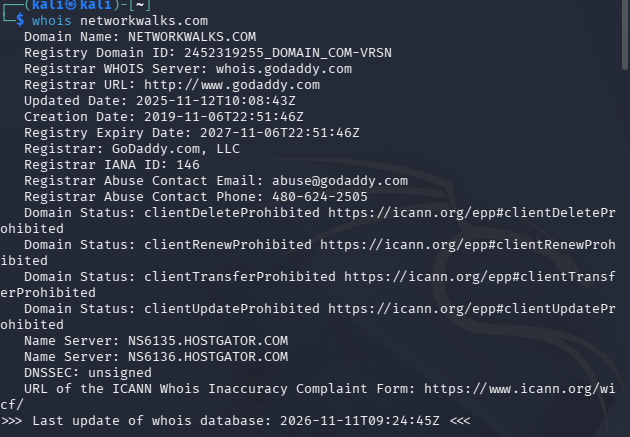


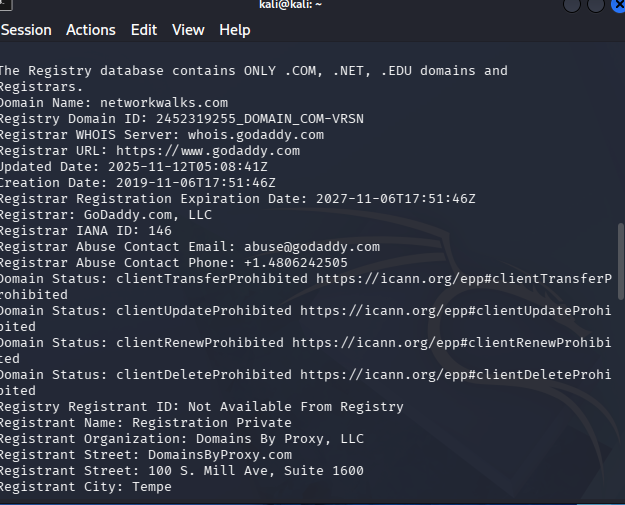


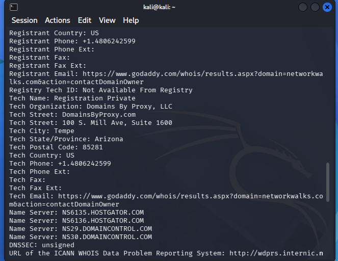

### WhatWeb
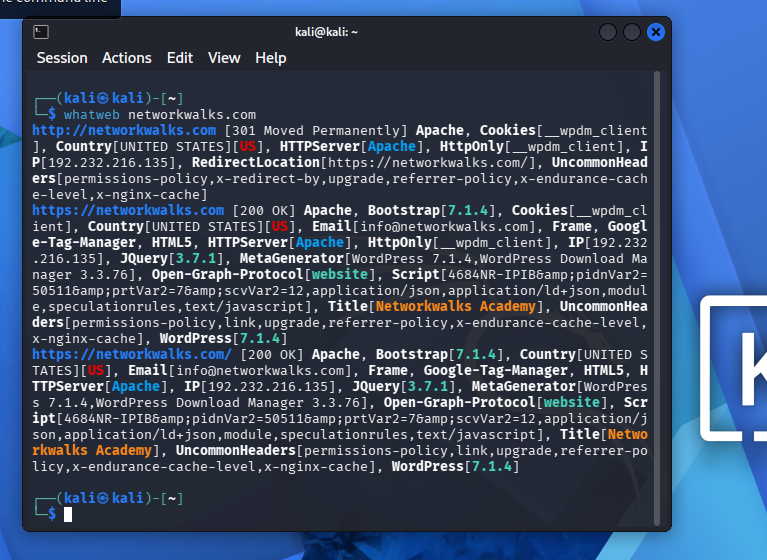

### Nslookup
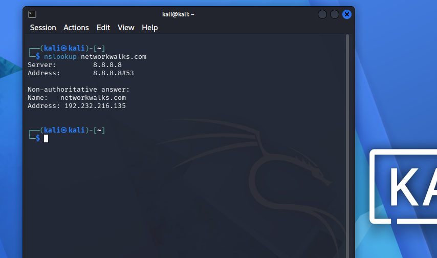

### Curl
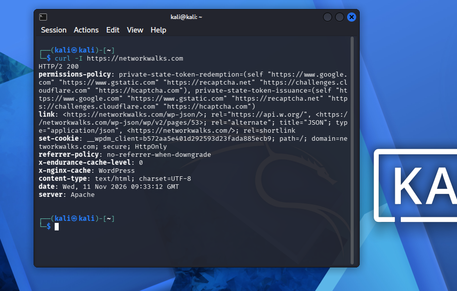

### Wafw00f
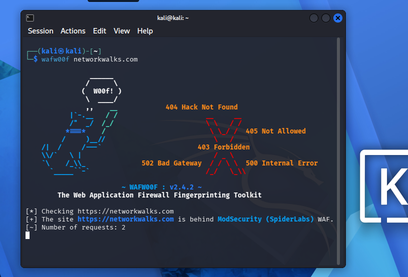

### DNSRecon
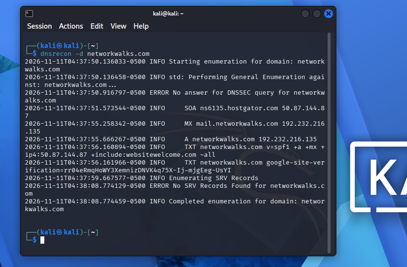

### theHarvester (bonus)
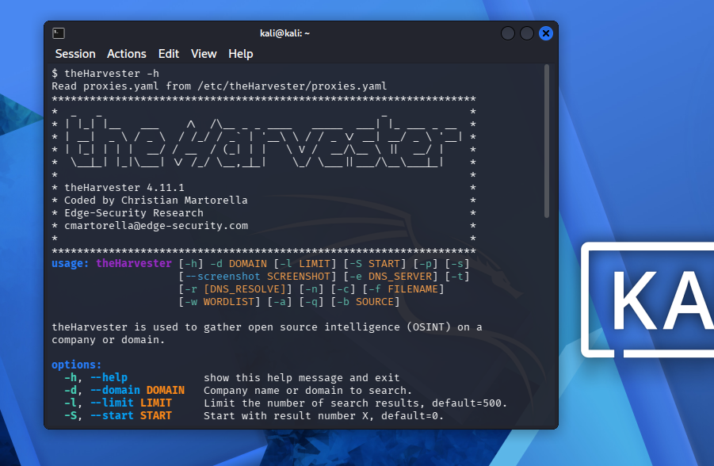

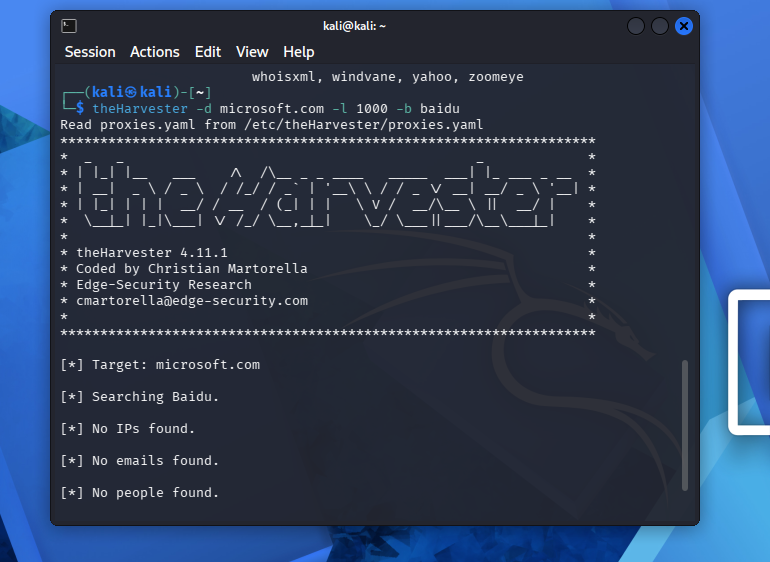


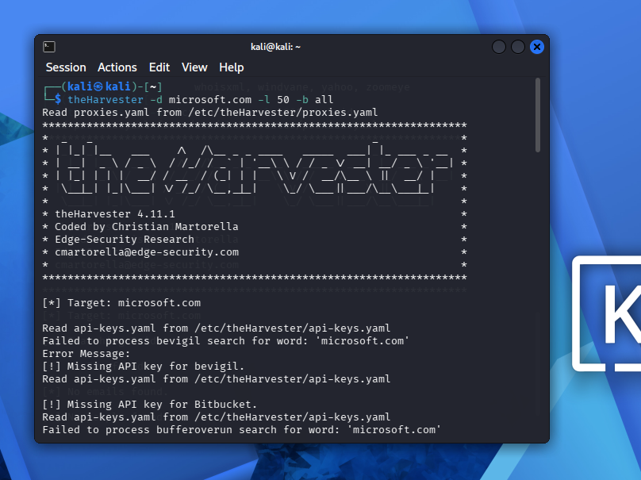


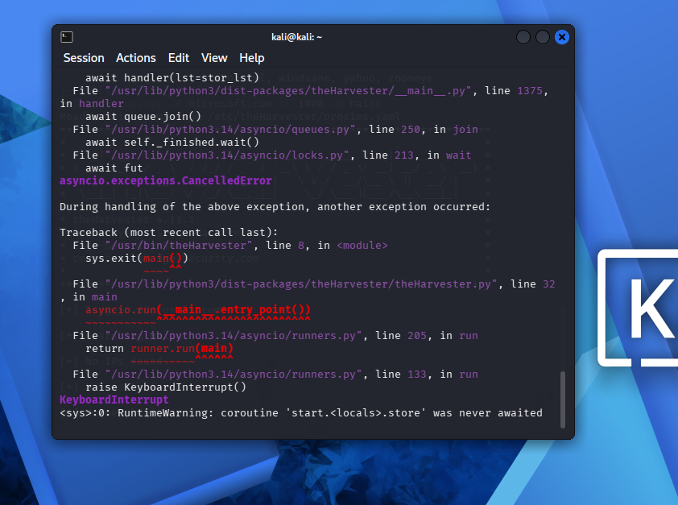

### Zenmap 

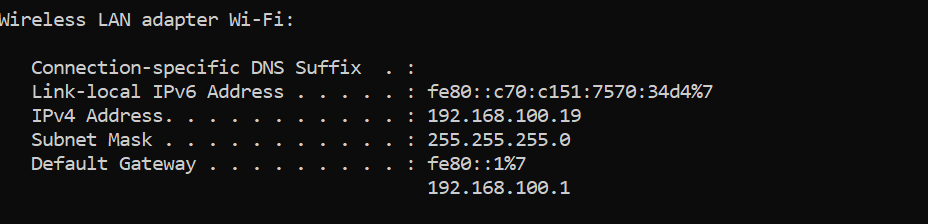

**Results of Quick Scan**
(images/quick_scan.png)

**Results of Ping Scan**
(images/ping_scan.png)

**Topology**
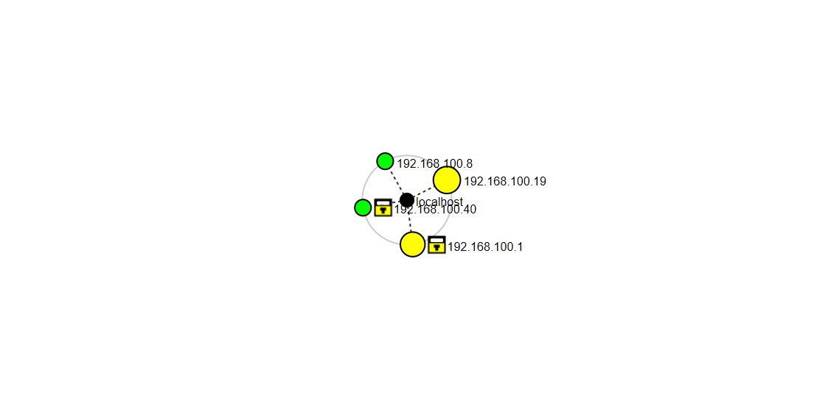
-->

---

**-End-**

## 👤 Author

**Mustabshra Rehman**
Cybersecurity Professional, B084

LinkedIn: https://www.linkedin.com/in/mustabshira-rehman-6bb4b7304/

## 📌 Project Information

**Program Name:** Cybersecurity program at Networkwalks | **Week:** 02 | **Repository:** GitHub
